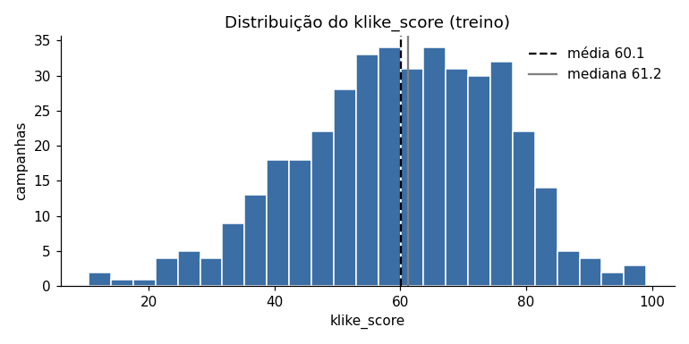
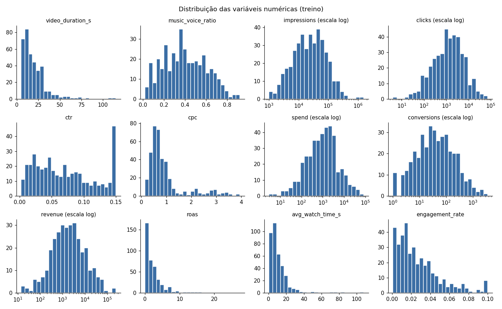
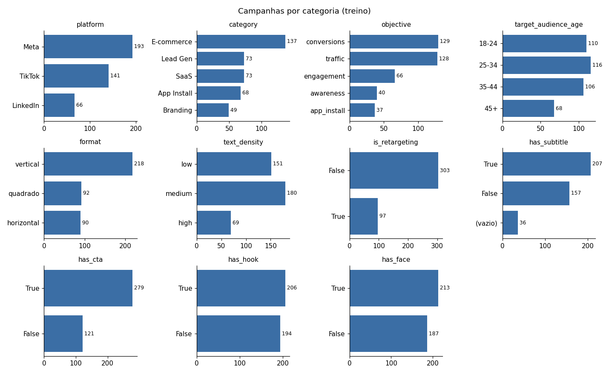
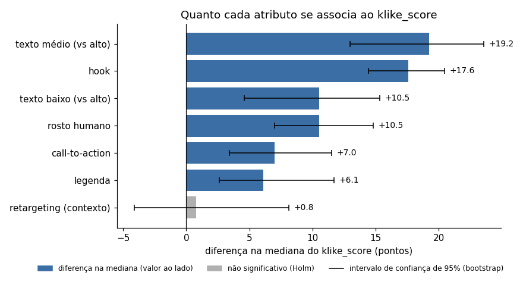
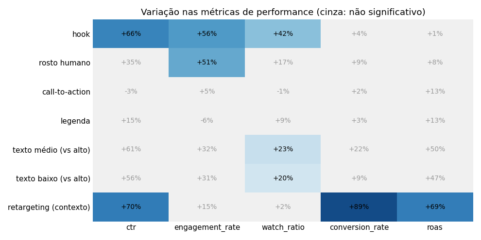
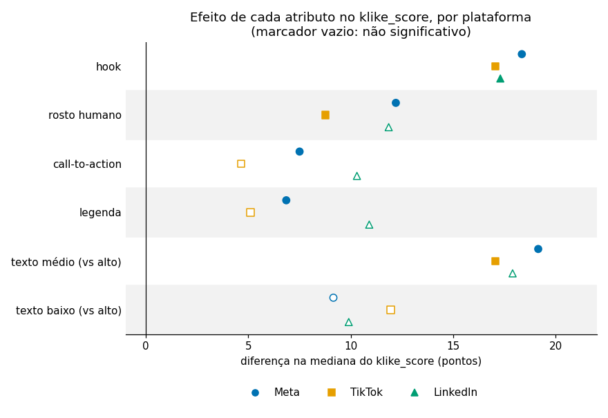
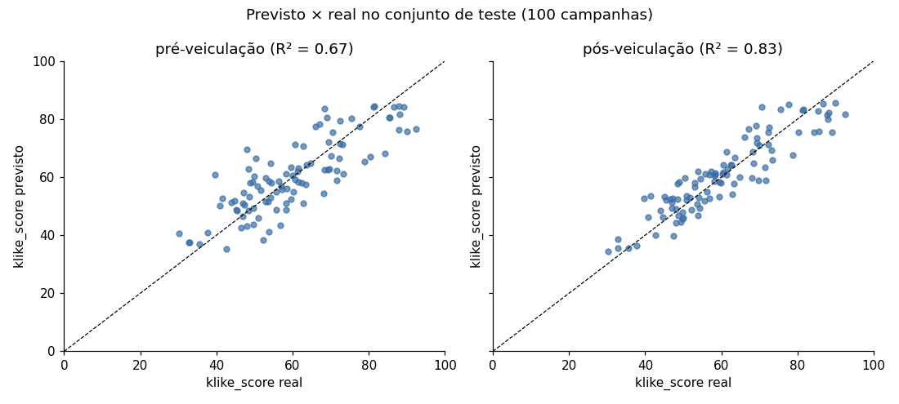
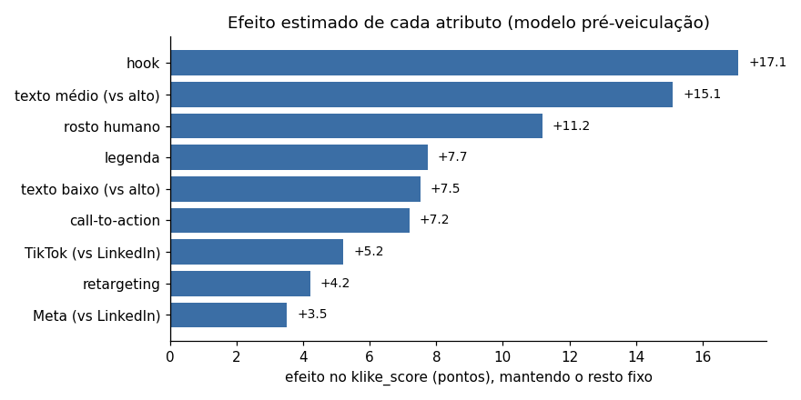
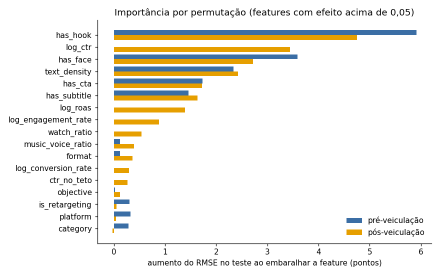

# Klike Data Science Challenge

Análise de 500 campanhas de vídeo veiculadas em Meta, TikTok e LinkedIn: exploração dos dados e um modelo que prevê o `klike_score` (qualidade do criativo, de 0 a 100).

## Resumo

- Antes de explorar, separei 20% dos dados para teste, que só serão usados na avaliação final do modelo.
- 10 campanhas tinham erro de registro em uma coluna (ex: 14 milhões de impressões em vez de 72 mil); todas foram recuperadas pelas outras colunas.
- O que mais pesa no `klike_score` é o criativo: texto em excesso na tela custa cerca de 19 pontos, e ter hook nos 3 primeiros segundos vale cerca de 18. Rosto humano, call-to-action e legenda vêm em seguida.
- O que funciona no TikTok funciona no LinkedIn: o efeito de cada atributo no score é praticamente o mesmo nas três plataformas.
- Hook e rosto aumentam CTR, engajamento e retenção. Conversão e ROAS dependem da audiência (retargeting), e não do criativo.
- Duração do vídeo, proporção música/voz e formato não mostraram relação com o score.
- Um modelo linear (Ridge) prevê o score com erro médio de 6,6 pontos usando só o criativo e o contexto da campanha (R² 0,68 no teste). Com as métricas de performance, o erro cai para 4,9 pontos (R² 0,83). Modelos de árvores não superaram o linear.

Os notebooks contêm o código e os resultados. Este README explica as decisões.

## Como rodar

Requer Python 3.10 ou superior.

```bash
python -m venv .venv
.venv\Scripts\activate          # Windows
# source .venv/bin/activate     # Linux/macOS
pip install -r requirements.txt
python -m notebook notebooks/
```

## Estrutura

```
├── data/
│   └── klike_challenge_dataset.csv   # dataset original, sem alterações
├── figures/                          # gráficos gerados pelos notebooks
├── notebooks/
│   ├── 01_eda.ipynb                  # Parte 1: análise exploratória
│   └── 02_modelo.ipynb               # Parte 2: modelo do klike_score
├── src/
│   ├── limpeza.py                    # correção de inconsistências, usada na EDA e no pré-processamento
│   ├── preprocessamento.py           # limpeza, features novas e codificação (passos do pipeline)
│   └── modelo.py                     # divisão treino/teste e os modelos finais
├── requirements.txt
└── README.md
```

---

## Parte 1 — Análise Exploratória

Notebook: [`notebooks/01_eda.ipynb`](notebooks/01_eda.ipynb)

A análise segue um roteiro fixo, do mais básico ao mais detalhado:

1. Contexto
2. Divisão treino/teste
3. Formato e tipos
4. Integridade (faltantes, duplicatas, valores impossíveis, tetos)
5. Distribuição de cada variável (valores comuns e raros, média vs mediana)
6. Relação entre pares de variáveis (ex: campanhas com hook têm CTR maior?)
7. Efeito de uma terceira variável (a relação se mantém dentro de cada plataforma?)
8. Registro dos achados

<details>
<summary><b>Por que seguir um roteiro?</b></summary>

Cada passo depende do anterior, não adianta medir a correlação entre duas variáveis (passo 6) se uma delas tem valores impossíveis (passo 4), nem confiar numa relação geral sem checar se ela se mantém dentro de cada plataforma (passo 7): uma relação observada no total pode sumir ou até se inverter dentro dos grupos. Seguir a mesma ordem evita pular verificações e torna a análise fácil de acompanhar.

</details>

### 1. Contexto

Cada linha é uma campanha: um vídeo veiculado em uma plataforma, com seus atributos e métricas de performance. O alvo é o `klike_score`. As 26 colunas se dividem em quatro grupos:

| Grupo | Colunas | O que representam |
|---|---|---|
| Identificação | `campaign_id`, `date` | Qual campanha e quando |
| Contexto da campanha | `platform`, `category`, `objective`, `target_audience_age`, `is_retargeting` | Decisões de mídia |
| Atributos do criativo | `video_duration_s`, `format`, `has_subtitle`, `has_cta`, `has_hook`, `has_face`, `text_density`, `music_voice_ratio` | Decisões de produção do vídeo |
| Métricas de performance | `impressions`, `clicks`, `ctr`, `cpc`, `spend`, `conversions`, `revenue`, `roas`, `avg_watch_time_s`, `engagement_rate` | Resultados depois que o anúncio rodou |

A pergunta central da EDA ("quais atributos do criativo se correlacionam com boas métricas de performance?") compara o terceiro grupo com o quarto.

### 2. Divisão treino/teste antes de explorar

Decisão: separar 20% das campanhas (100) como teste antes de qualquer análise, com `random_state=42` e estratificação por plataforma.

Por quê: o teste simula campanhas novas. Se ele influenciar as decisões da análise, ocorre um vazamento de dados: as escolhas ficam ajustadas ao próprio teste (um tipo de overfitting), e a nota final do modelo fica otimista demais.

| Plataforma | Base | Treino | Teste |
|---|---|---|---|
| Meta | 48,2% | 48,2% | 48,0% |
| TikTok | 35,2% | 35,2% | 35,0% |
| LinkedIn | 16,6% | 16,5% | 17,0% |

<details>
<summary><b>Por que dividir antes de explorar?</b></summary>

O conjunto de teste existe para medir como o modelo se sairia com campanhas que nunca viu. Se eu explorasse os 500 registros antes de dividir, o teste influenciaria minhas decisões mesmo sem querer:

- a mediana usada para preencher valores faltantes incluiria as campanhas de teste;
- as features seriam escolhidas olhando também para o teste;
- os outliers a remover seriam decididos vendo como aparecem no teste.

O teste deixaria de ser "novo": as decisões ficariam ajustadas a ele, um tipo de overfitting ao conjunto de teste, e a nota final seria otimista. Esse cuidado é conhecido como evitar *data snooping*. Por isso, toda a análise usa apenas o treino (400 campanhas).

</details>

<details>
<summary><b>Por que estratificar por plataforma?</b></summary>

Num sorteio simples, cada campanha tem a mesma chance de cair no teste, sem olhar a plataforma. O LinkedIn tem só 83 campanhas (17% da base), então o teste deveria receber cerca de 17, mas por acaso poderia receber bem menos ou bem mais. Numa base pequena, isso deixaria a avaliação por plataforma instável. Na divisão estratificada, o sorteio é feito dentro de cada plataforma (20% de cada uma), e os dois conjuntos ficam com a mesma composição da base, como mostra a tabela acima.

A plataforma foi escolhida sem olhar os dados: o enunciado destaca que "o que funciona no TikTok pode não funcionar no LinkedIn", e o engine de recomendações precisa considerar a plataforma.

Estratificar não causa vazamento de dados, ele só acontece quando informação do conteúdo do teste chega ao treino, como nos exemplos da seção anterior. A estratificação só controla quantas campanhas de cada plataforma vão para cada lado; nenhum atributo nem `klike_score` das campanhas de teste é usado. A proporção de plataformas no treino seria praticamente a mesma com um sorteio simples. A estratificação só remove a variação causada pelo acaso.

</details>

<details>
<summary><b>Por que 80/20 e random_state=42?</b></summary>

- 80/20 é um equilíbrio usual entre ter dados suficientes para aprender (400 campanhas) e uma avaliação de tamanho razoável (100).
- `random_state=42` fixa o sorteio, para que qualquer pessoa que rode o notebook obtenha exatamente a mesma divisão. O valor em si é arbitrário.

</details>

### 3. Formato e tipos

O que encontrei: a maioria das colunas foi lida com o tipo certo, e as categorias batem com o dicionário de dados, sem variações de escrita. Três colunas precisam de ajuste:

- `date` foi lida como texto, não como data.
- `has_subtitle` foi lida como `object` (True/False misturados com 36 vazios no treino), e não como booleano.
- `text_density` (low < medium < high) e `target_audience_age` (18-24 < 25-34 < 35-44 < 45+) têm ordem natural, mas foram lidas como texto sem ordem.

Decisão: corrigir esses tipos no pré-processamento, e não durante a análise.

Por quê: assim a mesma correção vale automaticamente para qualquer base nova (ex: uma campanha que o engine de recomendações vai avaliar), em vez de ficar presa a este notebook.

<details>
<summary><b>Como as categorias foram verificadas? E se surgirem novas plataformas no futuro?</b></summary>

O notebook compara as categorias encontradas no treino com as definidas no dicionário de dados do desafio (ex: as 3 plataformas, os 5 objetivos). Essa verificação pega erros de escrita, como "meta" em vez de "Meta", que fariam a mesma plataforma ser tratada como duas diferentes. No treino, todas as colunas bateram com o dicionário.

Uma categoria nova (ex: uma campanha do YouTube) não é tratada como erro: ela é apenas sinalizada como "fora do dicionário". Novas plataformas e categorias são esperadas conforme o produto cresce, e o aviso existe porque o modelo não terá aprendido nada sobre elas, então as previsões para esses casos seriam pouco confiáveis. Pelo mesmo motivo, o pré-processamento será construído para aceitar categorias novas sem quebrar.

</details>

### 4. Integridade

#### 4.1 Valores faltantes

O que encontrei:

- 7 colunas têm vazios, entre 5% e 9% cada: `video_duration_s`, `has_subtitle`, `music_voice_ratio`, `cpc`, `revenue`, `avg_watch_time_s` e `engagement_rate`.
- 62,5% das campanhas estão completas, e quase todas as outras têm um único campo vazio.
- As taxas de vazios são parecidas entre Meta, TikTok e LinkedIn.
- Comparando as campanhas com e sem vazio em cada uma das outras variáveis, nenhuma diferença continua significativa após corrigir para comparações múltiplas: não há evidência contra MCAR.
- A exceção provável é `avg_watch_time_s`: metade dos seus vazios (11 de 22) está nos 20% de campanhas com menos impressões, o que indica MAR. Uma explicação plausível é que, com poucas visualizações, a plataforma não reporta o tempo médio assistido.

Decisão: o tratamento dos vazios fica para o pré-processamento (Parte 2), e não para a análise.

Por quê: pelo mesmo motivo das correções de tipo, o tratamento precisa valer para qualquer base nova. O diagnóstico daqui orienta a escolha: para vazios ao acaso, preencher com um valor típico (ex: a mediana) é razoável; para `avg_watch_time_s`, o preenchimento deve considerar o tamanho da campanha, já que os vazios se concentram nas pequenas. Os vazios de `cpc` e `revenue` não precisam de estimativa: o passo 4.3 mostra que todos podem ser recalculados por `spend / clicks` e `roas × spend`.

<details>
<summary><b>Como foi testado o mecanismo dos faltantes?</b></summary>

Para cada coluna com vazios, comparei as campanhas com e sem o vazio nas demais variáveis: qui-quadrado nas categóricas e Mann-Whitney nas numéricas. Usei Mann-Whitney em vez de comparar médias porque impressões, gasto e ROAS têm cauda longa (mesmo depois de corrigir os erros de registro do passo 4.3, a maior campanha tem cerca de 67 vezes as impressões da mediana), e uma única campanha extrema dominaria a média de um grupo.

Foram 117 comparações, então os p-valores foram corrigidos pelo método de Holm. Sem a correção, 4 comparações têm p < 0,05, menos que as cerca de 6 esperadas só por acaso; com a correção, nenhuma é significativa.

O teste só distingue MCAR de MAR. MNAR não pode ser verificado sem o valor ausente.

</details>

<details>
<summary><b>Por que avg_watch_time_s é tratado como exceção, se não passou na correção?</b></summary>

A correção de Holm controla os falsos positivos de uma busca ampla, mas também reduz o poder de detectar efeitos reais com poucos casos (22 vazios). Três evidências se somam: os menores p-valores da busca (0,002 para impressões e 0,003 para gasto), medianas de impressões e gasto cerca de três vezes menores nas campanhas com vazio e uma concentração nítida na faixa das menores campanhas. Existe também um mecanismo plausível. Como o padrão foi encontrado depois de procurar, ele é tratado como hipótese provável de MAR, e não como certeza. MNAR também é plausível, se um tempo assistido muito baixo simplesmente não for registrado. Nos dois casos, uma coluna indicadora de falta preservaria essa informação para o modelo.

</details>

#### 4.2 Duplicatas

O que encontrei: nenhuma duplicata em quatro níveis de verificação: linhas idênticas, `campaign_id` repetido, linhas idênticas ignorando o `campaign_id` e campanhas com o mesmo contexto e o mesmo vídeo (plataforma, categoria, objetivo, público, retargeting e atributos do criativo). Também não há nenhuma campanha presente no treino e no teste ao mesmo tempo.

Decisão: nenhuma linha removida. A checagem de sobreposição entre treino e teste é a única do EDA que usa o teste.

Por quê: uma campanha repetida nos dois conjuntos seria vazamento de dados, porque o modelo seria avaliado em um exemplo já visto no treino. A checagem compara apenas se as linhas são iguais, sem calcular estatísticas nem olhar o `klike_score` do teste, então não influencia nenhuma decisão de análise. Os níveis mais amplos cobrem o caso de uma mesma campanha cadastrada duas vezes com IDs ou métricas diferentes, que um teste de linhas idênticas não pegaria.

#### 4.3 Valores impossíveis e inconsistentes

O que encontrei:

- Nenhuma violação das regras que valem por definição: sem valores negativos, cliques nunca acima das impressões, conversões nunca acima dos cliques, tempo assistido nunca acima da duração do vídeo, taxas entre 0 e 1 e datas dentro de 2024.
- As métricas derivadas (`ctr = clicks / impressions`, `cpc = spend / clicks`, `roas = revenue / spend`) fecham com até 10% de diferença por arredondamento (os cliques são inteiros, o que dá no `ctr` uma diferença sempre menor que 1 clique, e o `roas` tem 2 casas decimais), exceto em 10 campanhas, em que a diferença passa de 70%. Não há casos intermediários.
- Cada uma dessas 10 campanhas tem exatamente uma coluna com erro de registro:

| Coluna com erro | Campanhas | Valor registrado | Valor recuperado |
|---|---|---|---|
| `impressions` | KLK-0148, 0232, 0258, 0413 | 12,6 a 14,1 milhões | 11.695 a 86.948 (`clicks / ctr`) |
| `cpc` | KLK-0100, 0240, 0416 | 20,00 a 26,05 | 0,39 a 0,98 (`spend / clicks`) |
| `spend` | KLK-0109, 0224, 0259 | 50.545 a 95.812 | 5,40 a 21.557 (`cpc × clicks`) |

- Receita zero não indica performance ruim: as 41 campanhas com receita zero e conversões registradas são todas de awareness ou engagement, e 47 das 49 campanhas de Branding têm receita zero. A receita dessas campanhas não é medida.
- Todos os vazios de `cpc` (20) e `revenue` (22) podem ser recalculados pelas outras colunas.

Decisões:

- Recuperar os valores das 10 campanhas pela própria conta, em vez de descartá-las ou marcá-las como faltantes. A regra fica em `src/limpeza.py` e é aplicada no pré-processamento, a qualquer base.
- Registrar a coluna alterada em `coluna_corrigida`, para auditoria. Ela não entra no modelo.
- Recalcular os vazios de `cpc` e `revenue` em vez de preenchê-los com a mediana.
- Tratar o `roas` de campanhas sem receita medida como "não se aplica", e não como zero. A forma exata fica para a Parte 2.

Por quê: o valor recuperado é exato, não uma estimativa, e descartar as 10 campanhas perderia 2,5% do treino sem necessidade. Manter os erros seria pior que descartar: são essas campanhas que criam a cauda absurda de impressões e gasto (14 milhões de impressões, gasto de 95 mil com 20 cliques), que distorceria qualquer média e o próprio modelo. Já `coluna_corrigida` não entra no modelo porque um erro de registro não diz nada sobre a qualidade do criativo; o valor dela é rastrear o que foi alterado.

<details>
<summary><b>Como a regra decide qual coluna está errada?</b></summary>

Quando `ctr = clicks / impressions` não fecha, o erro pode estar em `impressions` ou no próprio `ctr`; quando `cpc = spend / clicks` não fecha, em `spend` ou no `cpc`. A regra compara as duas versões possíveis da taxa (a registrada e a recalculada) com a mediana da plataforma no treino, em escala log, mantém a mais plausível e recalcula a outra coluna. Ex: em KLK-0259, o `cpc` registrado (0,27) é plausível para o TikTok, e o recalculado (4.790) não; logo o erro está no `spend`.

A escolha é confirmada por informações que a regra não usa. Nas correções de `cpc` e `spend`, o `roas` fecha com o valor escolhido e não fecharia com a alternativa: em KLK-0259, o gasto recuperado (5,40) reproduz exatamente o `roas` registrado (13,45); em KLK-0240, se o erro estivesse no gasto, o `roas` seria 0,17, e não os 4,31 registrados. KLK-0224 não tem receita, mas a alternativa daria um `cpc` de 4,81, 3,5 vezes o maior do Meta. Nas correções de `impressions`, a alternativa daria CTRs de 10 a 100 vezes menores que o mínimo da plataforma. Quando só o `roas` não fecha, não há uma terceira conta para desempatar, e a campanha é apenas sinalizada; isso não ocorre no treino.

A tolerância de 20% fica no meio do vão entre o arredondamento (até ~8%) e os erros (acima de 70%), então a regra não é sensível ao valor exato escolhido. As medianas de referência são calculadas apenas no treino.
</details>

<details>
<summary><b>A correção muda as conclusões do passo 4.1?</b></summary>

Não. Os testes de faltantes do 4.1 foram feitos com os dados brutos, que incluem os 10 erros. Repetidos com os valores corrigidos, as mesmas 4 comparações têm p < 0,05 e nenhuma sobrevive à correção de Holm. O padrão de `avg_watch_time_s` se mantém (medianas de impressões de 9.045 com vazio e 25.057 sem).
</details>

#### 4.4 Tetos e pisos

O que encontrei (no treino já corrigido no 4.3):

- `ctr` truncado no topo em 0,15: 42 campanhas (10,5%) estão exatamente nesse valor, contra 24 entre 0,13 e 0,15, e nenhuma acima. Os cliques foram ajustados junto (`clicks / impressions` também dá 0,15), então o CTR real dessas campanhas é desconhecido; só se sabe que é de pelo menos 15%.
- O teto do `ctr` não atinge campanhas ao acaso: as campanhas no teto têm `klike_score` mediano de 74,4, contra 59,3 nas demais (Mann-Whitney, p ≈ 2 × 10⁻⁷), e 74% delas usam hook, contra 49%.
- `engagement_rate` truncado em 0,10: 7 campanhas, todas do TikTok (5% da plataforma), sem diferença de `klike_score` em relação às demais (p ≈ 0,9).
- Pisos com efeito desprezível: `impressions` tem mínimo de exatamente 1.000 em 2 campanhas, cujo `ctr` indica 983 e 990; `video_duration_s` tem um leve acúmulo em 5 s (16 campanhas, contra 10 em 6 s), quase todas do TikTok.

Decisões:

- Manter os valores no teto e adicionar, no pré-processamento, as colunas indicadoras `ctr_no_teto` e `engagement_no_teto`.
- As recomendações do engine não projetam CTR acima de 15%.
- Pisos de `impressions` e `video_duration_s`: apenas registrados.

Por quê: remover as campanhas no teto descartaria 10,5% do treino e, como o teto concentra as campanhas de maior `klike_score`, enviesaria o modelo para baixo. O valor real não pode ser recuperado, porque os cliques foram ajustados junto. A coluna indicadora informa ao modelo que o valor real é "pelo menos 0,15", e não exatamente 0,15. Para a análise, o teto tem uma consequência direta: ele achata a diferença entre as melhores campanhas, então a relação entre CTR e `klike_score` vai parecer mais fraca do que é. No engine, prever CTR acima de 15% seria extrapolar além do que os dados mostram.

### 5. Distribuição de cada variável

A partir daqui, a análise usa o treino com os erros de registro corrigidos (4.3).



O `klike_score` é aproximadamente simétrico (média 60,1, mediana 61,2), vai de 10 a 99 e não tem acúmulo nos extremos. Não precisa de transformação.



- `impressions`, `clicks`, `spend`, `conversions` e `revenue` têm cauda longa: a média é de 2 a 5 vezes a mediana, e a assimetria cai para perto de zero em escala log. O comportamento é multiplicativo, típico de mídia paga.
- `cpc` tem dois grupos: o LinkedIn tem mediana de 2,38, cerca de três vezes a do Meta (0,80) e quatro vezes a do TikTok (0,51).
- Os tetos de `ctr` e `engagement_rate` (4.4) aparecem como barras isoladas no limite.
- A maioria dos vídeos tem entre 5 e 30 s.



- Nenhuma categoria rara: a menor é o objetivo `app_install`, com 37 campanhas (9%). O LinkedIn tem só 66 campanhas, então as análises dessa plataforma terão menos precisão.
- `category` e `objective` são estruturados: cada categoria aparece com só dois objetivos (ex: Branding só com awareness e engagement), e `app_install` só existe na categoria App Install.
- `platform` e `format` também: o TikTok não tem vídeos horizontais, e o LinkedIn quase não tem verticais (9 de 66). O efeito do formato vai se confundir com o da plataforma.

Decisão: aplicar transformação log às contagens e aos valores monetários no pré-processamento, caso entrem no modelo.

Por quê: em escala log essas variáveis ficam próximas de simétricas, e uma campanha grande deixa de dominar modelos sensíveis à escala, como a regressão linear.

### 6. Relação entre pares de variáveis

Para comparar campanhas de tamanhos diferentes, as métricas de performance são taxas, e não volumes: `ctr`, `engagement_rate`, retenção (`watch_ratio` = `avg_watch_time_s / video_duration_s`), taxa de conversão (`conversions / clicks`) e `roas`, este só onde a receita é medida. As diferenças são entre medianas, testadas com Mann-Whitney e corrigidas por Holm.





O que encontrei:

- Todos os atributos binários do criativo se associam ao `klike_score`. Os maiores efeitos são texto médio em vez de alto (+19,2 pontos, IC 95% de +13,0 a +23,6) e hook (+17,6, IC de +14,4 a +20,5).
- Hook e rosto agem nas métricas de atenção: hook aumenta CTR (+66%), engajamento (+56%) e retenção (+42%); rosto aumenta o engajamento (+51%).
- Nenhum atributo do criativo muda significativamente a conversão ou o ROAS. Essas métricas dependem da audiência: retargeting aumenta a conversão em 89% e o ROAS em 69%, mas não muda o score.
- CTA e legenda elevam o score sem efeito detectável nas métricas.
- Duração do vídeo e proporção música/voz não se relacionam com o score, o CTR ou a retenção.
- Entre as métricas, o score acompanha o CTR (Spearman +0,56) e a retenção (+0,42). Os volumes são redundantes entre si (cliques e gasto, +0,92) e quase não se relacionam com o score.
- Os atributos do criativo são praticamente independentes entre si (|r| ≤ 0,11), então o efeito de um não é reflexo de outro.

Conclusão: o `klike_score` avalia o criativo, e não a audiência ou o orçamento. Ele recompensa o que prende a atenção (hook, rosto, pouco texto) e também boas práticas (CTA, legenda) que não aparecem diretamente nas métricas.

<details>
<summary><b>Por que diferença de medianas, bootstrap e Holm?</b></summary>

As métricas têm cauda longa e tetos (passos 4.4 e 5), então medianas e Mann-Whitney são mais robustos que médias e teste t. Os intervalos de confiança das diferenças de mediana vêm de bootstrap (2.000 reamostragens), porque não há fórmula simples para eles. A correção de Holm é aplicada às 42 comparações da seção; efeitos com p < 0,05 só antes da correção, como rosto no CTR (+35%), ficam como hipóteses.
</details>

### 7. Efeito de uma terceira variável: a plataforma



O que encontrei:

- O efeito dos atributos no `klike_score` é praticamente o mesmo nas três plataformas: hook vale de 17 a 18 pontos, texto médio em vez de alto de 17 a 19, e rosto de 9 a 12 em todas. No LinkedIn, só o hook é significativo após a correção, por ter apenas 66 campanhas, mas os tamanhos de efeito são da mesma ordem.
- Nas métricas, os efeitos variam mais, mas com evidência fraca: rosto aumenta o CTR no TikTok e no LinkedIn (+66% e +64%), mas não no Meta (+3%), onde o ganho aparece no engajamento (+50%).
- O formato só parece importar no LinkedIn, onde vídeos verticais têm score bem menor (42,6 contra 58,2 dos horizontais). Mas são só 9 campanhas, com bem menos hook (22% contra 54%) e rosto (33% contra 54%): a diferença vem da composição desses vídeos, e não do formato.
- Duração e proporção música/voz também não têm efeito dentro de cada plataforma: nenhuma das 24 correlações com score, CTR, retenção e engajamento é significativa após a correção. No TikTok, vídeos acima de 30 s têm CTR mediano menor (2,7% contra 5,6%), mas são só 5 campanhas. Os dados não sustentam uma duração ideal por plataforma.
- O LinkedIn tem score mediano 6 a 7 pontos abaixo das outras plataformas. Parte disso é composição (mais campanhas com texto alto), mas comparando campanhas com o mesmo hook, rosto e densidade de texto ainda restam 4 a 5 pontos de diferença.
- Rosto aumenta o engajamento em todas as faixas etárias, com efeito menor no público 45+ (+15%, contra +45% a +61%).

Conclusão: para o score, o que funciona no TikTok funciona no LinkedIn. A plataforma muda o nível de partida, e não o efeito de cada atributo. Por isso as recomendações podem usar efeitos comuns, ajustando o ponto de partida por plataforma.

### 8. Registro dos achados

Problemas a corrigir no pré-processamento:

1. Tipos: `has_subtitle` para booleano (e `date` para data, se a data entrar no modelo).
2. Os 10 erros de registro, com `src/limpeza.py`.
3. Faltantes: `cpc` e `revenue` recalculados pelas outras colunas; demais colunas com a mediana do treino e coluna indicadora.
4. ROAS de campanhas sem receita medida como "não se aplica", e não como zero.
5. Indicadoras de teto para `ctr` e `engagement_rate`.
6. Transformação log nas variáveis de cauda longa.
7. Codificação que aceite categorias novas.

Hipóteses a testar com o modelo:

1. Atributos do criativo e contexto explicam boa parte do score, com efeitos aproximadamente aditivos. Uma regressão linear deve ir bem, e interações por plataforma devem ajudar pouco.
2. `text_density` deve ser tratada como categórica, e não como ordinal: o efeito não é monotônico (média > baixa > alta).
3. As métricas de atenção (`ctr`, retenção) devem aumentar o poder preditivo, mas só existem depois que o anúncio roda.
4. Duração, música/voz, formato, categoria e objetivo devem ter importância baixa.

---

## Parte 2 — Modelagem

Notebook: [`notebooks/02_modelo.ipynb`](notebooks/02_modelo.ipynb)

### Features

Decisão: treinar dois modelos, com conjuntos de features diferentes.

| Conjunto | Features | Quando existem |
|---|---|---|
| Pré-veiculação | atributos do criativo (hook, rosto, CTA, legenda, densidade de texto, formato, duração, música/voz) e contexto de mídia (plataforma, categoria, objetivo, público, retargeting) | antes de a campanha ir ao ar |
| Pós-veiculação | o anterior mais as métricas de performance, como taxas: CTR, CPC, engajamento, retenção, conversão e ROAS | depois que a campanha roda |

Por quê: as métricas de performance só existem depois da veiculação. O modelo pré-veiculação é o que permite simular mudanças no criativo de uma campanha nova. O pós-veiculação mede quanto do score é explicado pelo desempenho observado.

Features novas, todas motivadas pela EDA:

- `watch_ratio` (tempo assistido / duração) e `conversion_rate` (conversões / cliques): taxas comparáveis entre campanhas de tamanhos diferentes. O tempo assistido absoluto é dominado pela duração do vídeo (passo 6).
- Taxas em log (CTR, CPC, engajamento, conversão, ROAS): a relação com o score é multiplicativa. Em testes exploratórios com validação cruzada, a versão em log teve erro levemente menor no modelo pós-veiculação (RMSE 6,18 contra 6,33).
- `ctr_no_teto` e `engagement_no_teto`: o valor real é desconhecido acima do teto (passo 4.4).
- `roas_nao_se_aplica`: receita não medida, em vez de ROAS zero (passo 4.3).

Ficaram de fora: volumes (impressões, cliques, gasto, conversões, receita), que medem o tamanho da campanha e quase não se relacionam com o score (passo 6); `date`, sem sazonalidade no score; e `campaign_id`.

Codificação: toda a limpeza da EDA é o primeiro passo do pipeline (`LimpezaCampanhas`), e por isso é reajustada dentro de cada fold e aplicada igual em campanhas novas. Categóricas em one-hot com `handle_unknown="ignore"`, incluindo `text_density` e faixa etária, cujos efeitos não são monotônicos (passo 8). Binárias sem padronização, para que o coeficiente seja o efeito em pontos de ter o atributo. Numéricas com mediana do treino, coluna indicadora de falta e padronização.

### Validação e escolha do modelo

Decisão: validação cruzada 5-fold repetida 3 vezes no treino, com os mesmos folds para todos os candidatos e hiperparâmetros escolhidos por busca em grade. Métrica principal, definida antes dos resultados: RMSE, em pontos de score. Modelo escolhido: Ridge nos dois conjuntos.

| Features | Modelo | RMSE | MAE | R² |
|---|---|---|---|---|
| — | baseline (média) | 15,87 | 12,84 | −0,02 |
| Pré-veiculação | Ridge | 8,73 | 6,97 | 0,69 |
| Pré-veiculação | Gradient Boosting | 8,91 | 7,09 | 0,68 |
| Pré-veiculação | Random Forest | 9,59 | 7,78 | 0,63 |
| Pós-veiculação | Ridge | 6,18 | 4,88 | 0,84 |
| Pós-veiculação | Gradient Boosting | 6,62 | 5,36 | 0,82 |
| Pós-veiculação | Random Forest | 8,05 | 6,51 | 0,74 |

Por quê: o Ridge tem o menor erro nos dois conjuntos. No pré-veiculação, a vantagem sobre o Gradient Boosting (0,18 ± 0,27 ponto, comparando fold a fold) é um empate, e no empate fica o modelo mais simples e interpretável. No pós-veiculação, o Ridge é melhor em 13 de 15 folds. As árvores não ganham porque os efeitos são aditivos e iguais entre plataformas (passos 6 e 7): com 400 campanhas, a flexibilidade extra só acrescenta variância.

Duas checagens confirmam a escolha:

- Interações atributo × plataforma não melhoram o Ridge (RMSE 8,81 contra 8,74), como previsto no passo 7.
- Com o `klike_score` embaralhado, o R² cai para abaixo de zero: o desempenho vem de relações reais, e não de vazamento.

### Resultado no teste

O teste foi usado uma única vez, com os modelos já escolhidos.

| Modelo | RMSE | MAE | R² |
|---|---|---|---|
| baseline (média) | 14,37 | 11,67 | 0,00 |
| Ridge pré-veiculação | 8,20 | 6,58 | 0,68 |
| Ridge pós-veiculação | 5,95 | 4,92 | 0,83 |



- Só com o criativo e o contexto, o modelo erra em média 6,6 pontos numa escala de 0 a 100, contra 11,7 de prever sempre a média. Os valores de teste são próximos aos da validação cruzada, então a busca de hiperparâmetros não inflou a estimativa.
- O modelo pré-veiculação comprime os extremos: subestima scores muito altos e superestima os muito baixos. O que ele não explica depende do desempenho observado, como o CTR, e o modelo pós-veiculação corrige boa parte disso.
- O erro é maior no TikTok (MAE 8,2 no pré-veiculação) que no Meta (6,0) e no LinkedIn (5,0).
- Os resíduos não têm padrão em relação à previsão, o que indica que a forma linear é adequada.

### Importância das features





- O que mais pesa no score é o criativo: hook (+17,1 pontos), texto médio em vez de alto (+15,1), rosto (+11,2), legenda (+7,7), texto baixo em vez de alto (+7,5) e CTA (+7,2), mantendo o resto fixo. Os efeitos ajustados são quase iguais às diferenças brutas da EDA, porque os atributos do criativo são quase independentes entre si.
- No modelo pós-veiculação, o CTR é a segunda feature mais importante, depois do hook, seguido de ROAS e engajamento.
- Plataforma, categoria, objetivo, formato, duração e música/voz quase não importam. O LinkedIn fica de 3,5 a 5,2 pontos abaixo das outras plataformas.

Faz sentido do ponto de vista de negócio: o score mede a qualidade do criativo, e os atributos que mais pesam são os que prendem a atenção nos primeiros segundos, coerentes com o efeito deles no CTR e na retenção (passo 6). A importância é medida por permutação nas features já limpas, no teste, com os níveis de cada categoria embaralhados juntos.
